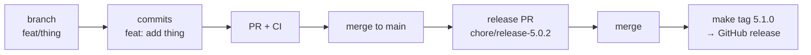

# Development workflow

How a change gets from an idea to a tagged release. Three rules carry the whole
process:

1. **Every commit is a Conventional Commit.** The type decides the changelog
   section and the version bump.
2. **Every change lands through a pull request into `main`.** No direct pushes.
3. **The version lives in the git tag.** Never in `composer.json` or
   `package.json`; there is no `version` field to bump.

## Worked example

Two roles take part: **contributors** open pull requests, **maintainers** merge
them and cut releases. Both use the same commands anyone can run locally.

### Contributor: one change

```bash
git switch main && git pull
git switch -c fix/cart-quantity

git add backend/models/Cart.php
git commit -S -m "fix(cart): keep the quantity when a line item is edited"
git push -u origin fix/cart-quantity

gh pr create --fill
```

Then CI lints the commit (`commits.yml`) and runs the suite (`main.yml`). The
contributor is done; the commit message is now the changelog entry.

### Maintainer: review, release, publish

```bash
# 1. review the pull request and merge it (squash or merge commit)
gh pr merge --squash --delete-branch

# 2. cut the release on a branch of its own
git switch main && git pull
git switch -c chore/release-5.0.2
make release                    # writes ## [5.0.2] from the commits since 5.0.1
git diff CHANGELOG.md           # read it; edit the wording when it is thin
git push -u origin chore/release-5.0.2
gh pr create --fill
#    ... merge it ...

# 3. publish the tag — this is the release
git switch main && git pull
make tag                        # tags 5.0.2 and pushes it; CI creates the release
```

Only a maintainer decides the version, edits the changelog section and pushes the
tag. Everything else in the cycle is open to any contributor.



## One-time setup

```bash
make hooks      # enable the commit-msg hook
make up         # start the Docker stack
```

`make install` and `npm ci` run `husky`, which points `core.hooksPath` at
`.husky/`, so the hook is also installed on a fresh clone.

## Branches

Branch off `main` and open a pull request back into `main`.

| Prefix | Use for |
| --- | --- |
| `feat/<slug>` | new behaviour |
| `fix/<slug>` | bug fix |
| `chore/<slug>` | tooling, dependencies, housekeeping |
| `docs/<slug>` | documentation only |
| `ci/<slug>` | workflow changes |

Keep the branch small and focused. A pull request that mixes a refactor, a
behaviour change and a release is hard to review and produces a noisy changelog.

## Commits

```
<type>(<scope>)!: <subject>

<body — why, not what>

<footer — BREAKING CHANGE: ..., Refs: #123>
```

```bash
feat(cart): add a quantity selector to the line item
fix(docker): wait for MySQL before starting the console
docs: point the README at the new installation guide
chore(deps): bump webpack to 5.112
feat(api)!: drop the v1 response envelope
```

| Type | Changelog section | Bump |
| --- | --- | --- |
| `feat` | Added | minor |
| `fix` | Fixed | patch |
| `perf`, `refactor`, `docs` | Changed | patch |
| `revert` | Removed | patch |
| `chore(security)` | Security | patch |
| `chore`, `ci`, `build`, `test`, `style` | not listed | patch |

A breaking change — `!` before the colon or a `BREAKING CHANGE:` footer — is
marked **Breaking:** in the changelog and bumps the major version.

Rules enforced by `commitlint.config.js`:

- first line at most 100 characters, no trailing period, imperative mood;
- scope lowercase and short — `(deps)`, `(docker/nginx)` — because it is used
  as a filter and as a changelog prefix;
- one logical change per commit. If the subject needs an "and", split it.

The `commit-msg` hook runs commitlint on every commit. `git commit --no-verify`
skips it, and CI runs the same check on the whole pull request, so skipping only
delays the failure.

### Signing

`main` requires verified signatures. `commit.gpgsign` and `tag.gpgsign` are
enabled in this repository, so a plain `git commit` signs; pass `-S` explicitly
if your local configuration does not:

```bash
git commit -S -m "feat(cart): add a quantity selector"
```

`make release` commits with `-S` and `make tag` creates a signed tag with `-s`,
so the release objects are signed regardless of local configuration. Check them
with:

```bash
git log --format='%h %G? %s' -5      # G = good signature
git tag -v 5.1.0
git log --show-signature -1
```

Only commits that land on `main` need a signature — a squash or merge done in the
GitHub UI is signed by GitHub. Signing everything anyway keeps the history uniform
and catches a broken key before merge instead of after.

## Before opening a pull request

```bash
make verify     # composer validate + audit, npm audit, commitlint, Codeception
```

`make lint` runs only the static checks, `make test` only the suite. CI runs the
same commands, so a green `make verify` means a green pull request in practice.

## Releasing

The release branch starts at the latest `main`, never at a feature branch.

```bash
git switch main && git pull
git switch -c chore/release-5.1.0
make release                  # version from the commits, e.g. 5.1.0
make release VERSION=6.0.0    # or force one
```

`make release`:

1. runs `git-cliff --unreleased --tag <version> --prepend CHANGELOG.md`, which
   turns every commit since the last tag into a Keep a Changelog section;
2. commits it as `chore(release): <version>`, signed.

Then:

1. Read the generated section. It is plain Markdown written from commit
   subjects — merge related entries, drop noise, add the "why" when it matters.
   `make changelog` previews without writing anything.
2. Open a pull request `chore/release-<version>` and merge it.
3. Publish the tag from `main`:

   ```bash
   git switch main && git pull
   make tag          # or make tag VERSION=5.1.0
   ```

The **tag is the release**. It is signed (`git tag -s`), so `git tag -v 5.1.0`
verifies it locally. `.github/workflows/release.yml` then publishes the
GitHub release from that section, and Packagist picks the tag up on its own.
`make tag` refuses to run from another branch, on a version `CHANGELOG.md` does
not document, or for a tag that already exists — so a mis-typed or premature tag
fails locally instead of on GitHub.

### Version numbers

`major.minor.patch`, following Semantic Versioning, derived from the commits:

- breaking change → **major** (`5.4.2` → `6.0.0`)
- `feat` → **minor** (`5.4.2` → `5.5.0`)
- `fix` and everything else → **patch** (`5.4.2` → `5.4.3`)

`make release` refuses to run when there is nothing but `chore`/`docs` commits,
because those do not justify a release of their own.

## Hotfix

Branch `fix/<slug>` from the latest tag, fix, pull request, then run the normal
release flow to cut a patch release.

## What CI enforces

| Workflow | Checks |
| --- | --- |
| `main.yml` | PHP 8.4/8.5 against MySQL 8.4, `composer validate --strict`, `composer audit`, Codeception, `npm ci` + audit + `npm run build` |
| `commits.yml` | every commit in the pull request passes commitlint |
| `release.yml` | on a pushed `x.y.z` tag: checks the tag matches `CHANGELOG.md`, then creates the GitHub release |

## Tooling

| File | Role |
| --- | --- |
| `commitlint.config.js` | allowed types, scope and header rules |
| `.husky/commit-msg` | runs commitlint before a commit is created |
| `cliff.toml` | git-cliff template: commit type → changelog section |
| `Makefile` | `make help` lists every shortcut |
